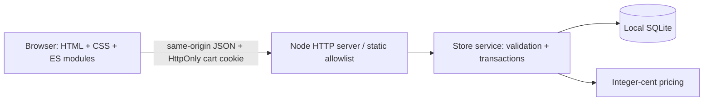
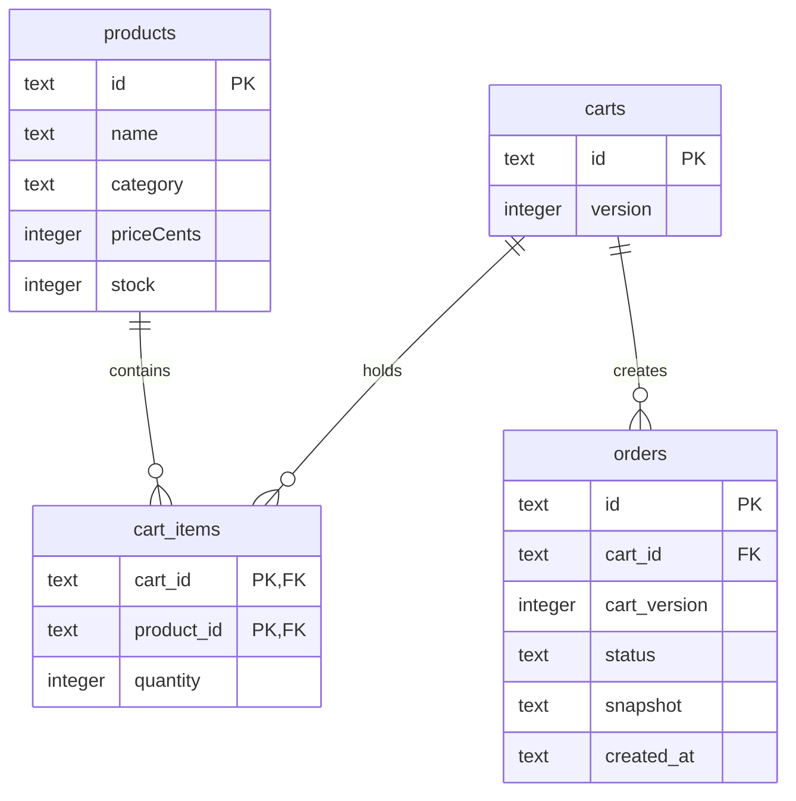

# Everyday Market design

## Scope and visual direction

A local, single-process ecommerce demo for GitHub Agentic Workflows, not a
production store. A warm neutral canvas, forest-green actions, sage accents,
CSS-drawn product illustrations, and an editorial hero make the catalog feel
like a small real retailer. No external images, fonts, CDN, or npm dependencies
are required. Illustrations are decorative; product names are accessible text.

Desktop: editorial hero, category/search toolbar, three-column catalog, sticky
bag. Tablet: two-column catalog. Below 760px: stacked hero/catalog/bag and a
single-column payment screen. Buttons have visible keyboard focus, category
buttons use `aria-pressed`, and status/error messages use live regions. The
theme switch is deliberately unfinished (THEME-001).

## Components and request flow

- `public/app.js`: catalog, search, category state and bag controls.
- `public/payment.js`: order creation/retrieval and simulated confirmation.
- `public/shared.js`: JSON error handling, safe DOM creation, USD formatting.
- `src/server.js`: static routes, JSON limits, same-origin write checks, cookies,
  explicit 4xx responses and logged unexpected 500 errors.
- `src/store.js`: prepared SQL statements, seed data and transaction boundaries.
- `src/pricing.js`: shared authoritative order calculation; its original defect
  is preserved as PRICE-001.

The server binds only to `127.0.0.1`. Default port is 3000; `PORT` overrides it.
`DATABASE_PATH` overrides `data/store.sqlite`. Node 24's built-in `node:sqlite`
provides a real file-backed SQL database. It is SQLite, not SQL Server LocalDB;
there is no ORM or separate database installation.

## Relational model

Nine deterministic products seed with `INSERT OR IGNORE`, so restart does not
reset inventory. Orders retain an immutable JSON snapshot of line items and
server-calculated totals; normalized carts/products remain queryable in SQL.
Each browser receives an opaque cart ID in an HttpOnly, SameSite=Lax cookie.
Browsers do not share bags. Treat the cookie as a local session capability,
not user authentication.

## API contract

All money is integer USD cents. Categories are `electronics`, `appliances`,
`mobiles`. Errors are `{ "error": "message" }` with non-2xx status.

| Method | Route | Request / response |
| --- | --- | --- |
| GET | `/api/health` | `{status:"ok",database:"sqlite"}` |
| GET | `/api/categories` | `{categories:[{id,name}]}` |
| GET | `/api/products?category=&search=` | `{products:[...]}`; search <=100 chars |
| GET | `/api/cart` | `{items,itemCount,totals}`; creates cookie if needed |
| POST | `/api/cart/items` | `{productId,quantity}` -> updated cart |
| PATCH | `/api/cart/items/:id` | `{quantity}` -> updated cart |
| DELETE | `/api/cart/items/:id` | updated cart |
| POST | `/api/checkout` | 201 order snapshot, pending; empty cart ->409 |
| GET | `/api/orders/:id` | current session's order, otherwise 404 |
| POST | `/api/orders/:id/pay` | simulated paid order; repeat is idempotent |

JSON mutation bodies require `application/json`, at most 8KiB; quantity must be
an integer 1..99 and not exceed stock. Explicit quantity updates and removal
work in the baseline. The repeated-add and category predicates intentionally
violate their contracts; see [exercises](exercises.md).

## Checkout and inventory

1. Intended navigation: bag -> `/payment`. Baseline link is intentionally wrong.
2. The payment page POSTs checkout (or reloads `?order=<id>`).
3. Checkout snapshots the current cart version. A repeated checkout at the same
   version reuses the pending order; it does not reserve stock.
4. Simulate payment validates ownership, cart version and current stock inside
   `BEGIN IMMEDIATE`. All stock decrements, order status and cart clearing commit
   atomically; any conflict rolls everything back.
5. Repeated payment of a paid order returns its confirmation without deducting
   stock again. A changed cart requires a new checkout. Concurrent shoppers may
   see an explicit stock conflict and must adjust their bags.

## Pricing rules

An automatic 10% merchandise promotion, $10 shipping for nonempty bags, and 0%
demo tax are supplied by the server, never trusted from browser totals.
Discount merchandise only; round discount and discounted-merchandise tax to
whole cents; shipping is neither discounted nor taxable. An empty cart is zero.
The deliberate paid-shipping discount bug does **not** redefine these rules.

## Limits and validation

No accounts, address collection, real payment provider, card fields, fulfillment,
refunds or production deployment. Cookie expiry is seven days; no cart/order
retention job is implemented. SQLite is synchronous and suitable for this small
local demo, not a high-throughput production backend. Back up the database if
you want to preserve it; ignored local databases must never be committed.

Tests use fresh in-memory databases or named disposable temp directories.
Coverage includes validation, sessions, file persistence, immutable snapshots,
stock-conflict rollback, stale-order rejection and idempotent payment.
[Exercise checks](exercises.md) intentionally fail until agents fix each issue.
